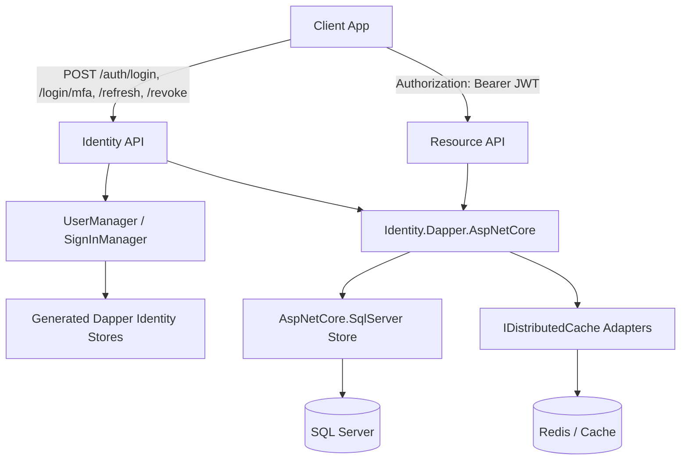
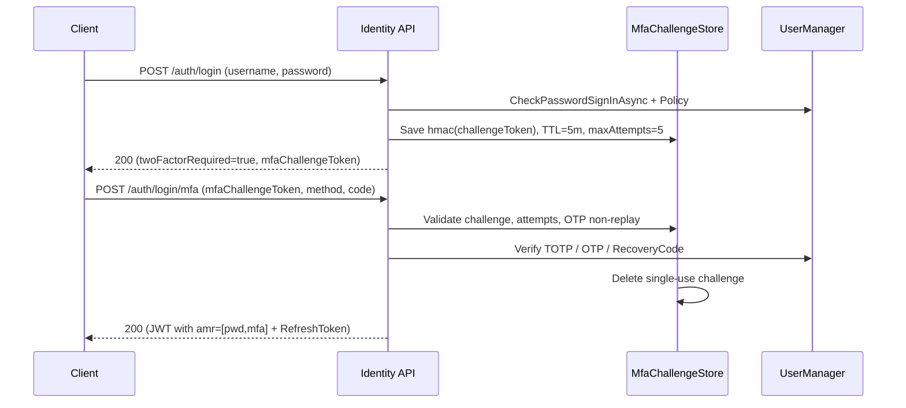

# Plan: ASP.NET Core Identity JWT Endpoints, Multi-Factor Authentication, and Token Revocation

Date: 2026-11-10  
Status: Proposed implementation plan for `AdaskoTheBeAsT.Identity.Dapper`

## 1. Goal and Scope Boundary

Provide optional, reusable ASP.NET Core packages in `AdaskoTheBeAsT.Identity.Dapper` that offer an ergonomic developer experience similar to `MapIdentityApi<TUser>()`, while issuing real signed JWT access tokens, supporting full multi-factor authentication (TOTP authenticator apps, email/SMS one-time codes, recovery codes, and policy-driven MFA enforcement), managing persistent single-use refresh-token sessions, and enforcing shared access-token and session revocation across distributed APIs.

### Scope principles

1. **Keep core Dapper Identity stores untouched:** Build against `UserManager<TUser>` and `SignInManager<TUser>` (plus `IUserAuthenticatorKeyStore<TUser>`, `IUserTwoFactorStore<TUser>`, `IUserTwoFactorRecoveryCodeStore<TUser>`, and `IUserAuthenticationTokenStore<TUser>`, which generated `AdaskoTheBeAsT.Identity.Dapper` stores already implement) so the package works with every supported database provider (`SqlServer`, `PostgreSql`, `MySql`, `Oracle`, `Sqlite`) and every supported key type (`Guid`, `int`, `long`, `string`).
2. **Zero third-party framework lock-in:** Use standard `Microsoft.Extensions.DependencyInjection` and ASP.NET Core Minimal APIs. Do not require consumers to install `MediatR`, `AutoMapper`, `FluentValidation`, or `SimpleInjector`.
3. **Separate token issuance from downstream validation:** Expose two independently usable capabilities:
   - **Identity Issuer, MFA, and Endpoints:** Authenticate primary credentials, run MFA challenges and enrollment, mint JWTs, rotate refresh tokens, and expose authentication endpoints.
   - **Resource-API Validation and Revocation:** Validate JWTs (including optional MFA `amr` policy checks) and check shared revocation state inside `JwtBearerEvents.OnTokenValidated` without requiring `AddIdentity`, `UserManager<TUser>`, or Identity user/role stores in downstream resource APIs.
4. **Honest protocol boundary:** Position this feature as **JWT and MFA authentication endpoints for ASP.NET Core Identity**, not a full OAuth 2.0 or OpenID Connect authorization server. OIDC discovery, authorization code + PKCE flows, consent screens, federated identity brokering, and dynamic client registration belong in dedicated authorization-server frameworks.

---

## 2. Cryptographic Recommendations (2026 Baseline)

`SHA-256` and related primitives serve several distinct roles in an authentication system. Modern standards (NIST SP 800-63B-4, NIST SP 800-131A, IETF RFC 9700 OAuth 2.0 Security Best Current Practice, RFC 6238 TOTP, and OWASP Authentication / JWT Cheat Sheets) treat each role differently:

### 2.1 Hashing opaque tokens and MFA challenge secrets at rest: `HMAC-SHA-256` preferred, plain `SHA-256` acceptable only for high-entropy CSPRNG inputs

| Mechanism | Verdict for Opaque Tokens | Rationale |
| --- | --- | --- |
| **Keyed `HMAC-SHA-256` (Recommended Default)** | **Preferred** | Refresh tokens, MFA challenge tokens, and out-of-band setup tokens are 256-bit (32-byte) `RandomNumberGenerator` values. Computing `HMACSHA256.HashData(pepperKey, tokenBytes)` with an application-held secret key stored outside the database (e.g., Key Vault, KMS, environment secret) provides secret separation: a database-only compromise cannot verify candidate tokens or brute-force short 6-digit email OTP codes stored in challenge records without the host secret. Note that for short 6-digit email/SMS OTP codes (`10^6` space), keyed `HMAC-SHA-256` (with challenge-id binding) is **mandatory** rather than plain `SHA-256`, because an unkeyed `SHA-256` of a 6-digit number is trivially invertible from a database dump. |
| **Plain `SHA-256`** | **Acceptable fallback for 256-bit tokens only** | Cryptographically safe *only* when the input has >= 128 bits (here 256 bits) of uniform CSPRNG entropy ($2^{256}$ search space makes offline brute-force and rainbow tables infeasible). Acceptable for 256-bit refresh tokens in zero-pepper development setups, **never** for 6-digit OTP codes or passwords. |
| **Argon2id / PBKDF2 / bcrypt** | **Passwords only, not 256-bit tokens** | Slow memory-hard KDFs are mandatory for low-entropy human passwords, not 256-bit CSPRNG tokens. Running Argon2id on `/refresh` adds avoidable CPU/memory DoS surface and prevents `O(1)` indexed database lookups. |
| **Plain SHA-1 / MD5** | **Forbidden** | Collision-broken and flagged by repository security analyzers (`CA5350`, `CA5351`). |

**Design decision for this library:**
- Generate opaque refresh tokens, MFA challenge tokens, and MFA setup-link tokens from `RandomNumberGenerator.GetBytes(32)` (256 bits of entropy), encoded as Base64Url without padding.
- Implement `ITokenSecretHasher` using **`HMAC-SHA-256`** (`TokenHashKey` >= 32 bytes, plus `PreviousTokenHashKeys` and `HashKeyId` for zero-downtime secret rotation). Require `TokenHashKey` whenever email/SMS OTP challenges are stored, and allow unkeyed `SHA-256` fallback strictly for 256-bit tokens in `Development` when explicitly enabled.
- Always compare digests in memory with `CryptographicOperations.FixedTimeEquals`.

### 2.2 Authenticator TOTP (`HMAC-SHA-1` per RFC 6238 vs `HMAC-SHA-256`) and Stored TOTP Secrets

- **Why TOTP uses `HMAC-SHA-1` (`algorithm=SHA1`, 6 digits, 30-second step):** While plain SHA-1 is broken for collision resistance in certificates/signatures, `HMAC-SHA-1` as a PRF in short-lived 6-digit TOTP (RFC 6238) remains unbroken and explicitly permitted by NIST SP 800-131A for OTP interoperability. Crucially, major mobile authenticator apps (including widely deployed Google Authenticator and Microsoft Authenticator builds) default to or silently force `SHA1` even if `algorithm=SHA256` is placed in the `otpauth://` URI, causing silent verification failures for end users. Relying on ASP.NET Core Identity's built-in `AuthenticatorTokenProvider<TUser>` (RFC 6238 `HMAC-SHA-1`, 6 digits, 30s step) guarantees universal app compatibility.
- **Email and SMS OTP codes:** Do *not* reuse a static TOTP secret with a 120-second step for email codes. Instead, generate a fresh 6-digit code per challenge/resend using `RandomNumberGenerator.GetInt32(0, 1_000_000)` (`D6`), bind it to the specific `ChallengeId`, and store only `HMAC-SHA-256(TokenHashKey, "{ChallengeId}:{Code}")` with an explicit expiration (e.g., 5 minutes) and attempt counter.
- **Protecting TOTP `AuthenticatorKey` at rest:** Unlike refresh tokens, a TOTP shared secret must be recoverable by the server to compute expected codes, so it cannot be one-way hashed. Support optional transparent encryption at rest via ASP.NET Core `IDataProtectionProvider` (`Purpose: "IdentityJwt.AuthenticatorKey.v1"`) before persisting in `AspNetUserTokens` (or `IdentityOptions.Stores.ProtectPersonalData`).

### 2.3 JWT signing algorithms: asymmetric `ES256` / `PS256` preferred over `HS256`

| Algorithm | Cryptographic Primitive | Recommendation |
| --- | --- | --- |
| **`ES256` / `ES384` (Recommended)** | ECDSA (P-256 + SHA-256 / P-384 + SHA-384) | **First choice for distributed systems.** Private key stays exclusively in the Identity issuer; downstream resource APIs receive only public verification keys. Compact 64/96-byte signatures, fast signing and verification, native BCL + OS FIPS support in .NET 10. |
| **`PS256` / `PS384`** | RSASSA-PSS (>= 2048-bit RSA, 3072-bit recommended past 2030) | **Preferred RSA mode.** Stronger probabilistic PSS padding than legacy PKCS#1 v1.5 while compatible with standard RSA key infrastructure. |
| **`RS256`** | RSASSA-PKCS1-v1_5 (>= 2048-bit RSA) | **Supported for compatibility** with legacy enterprise gateways and certificates; prefer `ES256` or `PS256` for new deployments. |
| **`HS256` / `HS384` / `HS512`** | HMAC-SHA-2 (>= 32 / 48 / 64 random bytes) | **Single-service monoliths only.** `HMAC-SHA-256` is cryptographically sound with a >= 256-bit random key, *not* a password, but every verifier holds the signing secret and can forge tokens. Never share an `HS256` secret across separate trust boundaries. |
| **`EdDSA` (`Ed25519`)** | Edwards-curve DSA (RFC 8037 / RFC 9864) | Supported via pluggable `IJwtSigningCredentialsProvider` when a compatible `SecurityKey` provider is registered. |

**Mandatory validation hardening:**
- Always populate `TokenValidationParameters.ValidAlgorithms` explicitly from configured verification keys to block `alg: "none"` and asymmetric-to-HMAC key-confusion attacks.
- Enforce `RequireSignedTokens = true`, `RequireExpirationTime = true`, `ValidateIssuer = true`, `ValidateAudience = true`, `ValidateLifetime = true`, and `ValidateIssuerSigningKey = true`.

### 2.4 Revocation store key normalization and user passwords

- Identify revoked tokens and sessions structurally by `(Issuer, Jti)`, `(Issuer, SessionId)`, and `(Issuer, UserId)` rather than hashing raw JWT strings.
- In `DistributedCacheTokenRevocationStore`, use `SHA256.HashData` strictly as a fixed-length collision-resistant cache-key normalizer over length-prefixed `(Issuer, ScopeType, SubjectKey)` tuples.
- User password hashing remains delegated to ASP.NET Core Identity's `IPasswordHasher<TUser>` (`PBKDF2-HMAC-SHA512` by default in .NET 10, or a consumer-registered `Argon2id` `IPasswordHasher<TUser>` per OWASP Password Storage Cheat Sheet).

---

## 3. Package and Project Architecture

Add two packable libraries so core ASP.NET Core JWT + MFA support stays free of database-specific ADO.NET drivers, while SQL Server gets a first-class durable store out of the box. Additional provider store packages (`PostgreSql`, `MySql`, `Oracle`, `Sqlite`) can implement the same store interfaces later.

| Project / Path | Target | Key Dependencies | Responsibility |
| --- | --- | --- | --- |
| `src/AdaskoTheBeAsT.Identity.Dapper.AspNetCore` | `net10.0` | `Microsoft.AspNetCore.App`, `Microsoft.AspNetCore.Authentication.JwtBearer`, `AdaskoTheBeAsT.Identity.Dapper` | 1. Identity endpoints, MFA workflows, and JWT issuance (`AddIdentityJwtApi<TUser>`, `MapIdentityJwtApi<TUser>`).<br>2. Standalone resource-API JWT validation and revocation check (`AddIdentityJwtValidation`).<br>3. `DistributedCacheTokenRevocationStore`, `DistributedCacheMfaChallengeStore`, and bounded in-memory stores. |
| `src/AdaskoTheBeAsT.Identity.Dapper.AspNetCore.SqlServer` | `net10.0` | `AdaskoTheBeAsT.Identity.Dapper.AspNetCore`, `Dapper`, `Microsoft.Data.SqlClient` | Durable, transactional SQL Server implementations (`SqlServerRefreshTokenStore`, `SqlServerTokenRevocationStore`, `SqlServerMfaChallengeStore`) and batched background expiry cleanup. |
| `db/SqlServer/IdentityJwt/` | SQL Server | SSDT / `.sql` scripts | Tables and indexes for refresh-token sessions, MFA challenges/OTP replay guards, and token revocations (works across all user key types). |
| `test/unit/AdaskoTheBeAsT.Identity.Dapper.AspNetCore.Test` | `net10.0` | `xunit.v3`, `AwesomeAssertions`, `Moq`, `Microsoft.AspNetCore.TestHost` | Unit and TestHost functional tests covering crypto, key rotation, password + MFA login flows, enrollment, OTP replay/brute-force protection, refresh rotation, revocation scopes, and store-outage policies. |
| `test/integ/AdaskoTheBeAsT.Identity.Dapper.AspNetCore.SqlServer.IntegrationTest` | `net10.0` | `Testcontainers.MsSql`, `xunit.v3` | Containerized SQL Server integration tests for atomic rotation, concurrent MFA challenge consumption, replay cascade revocation, and expired-row pruning. |



---

## 4. Public Developer Experience and API Surface

### 4.1 Identity Issuer Service Setup (with MFA)

```csharp
builder.Services
    .AddIdentity<ApplicationUser, ApplicationRole>()
    .AddUserStore<ApplicationUserStore>()
    .AddRoleStore<ApplicationRoleStore>()
    .AddDefaultTokenProviders();

builder.Services
    .AddIdentityJwtApi<ApplicationUser>(options =>
        builder.Configuration.GetSection("IdentityJwt").Bind(options))
    .AddSqlServerJwtStores(options =>
        options.ConnectionString = builder.Configuration.GetConnectionString("DefaultConnection"))
    .AddMfaCodeSender<ApplicationMfaCodeSender>()
    .AddClaimsProvider<CustomUserClaimsProvider>();

var app = builder.Build();

app.UseAuthentication();
app.UseAuthorization();

app.MapGroup("/auth")
   .MapIdentityJwtApi<ApplicationUser>(endpoints =>
   {
       endpoints.EnableRegistration = false; // opt-in only
       endpoints.EnableMfaEndpoints = true;  // default true
   })
   .RequireRateLimiting("auth-policy");
```

### 4.2 Standalone Downstream Resource API Setup

Downstream APIs validate tokens, enforce optional MFA assurance policies (`amr`), and check shared revocation without registering `ApplicationUser`, `UserManager<TUser>`, or Identity user/role stores:

```csharp
builder.Services
    .AddIdentityJwtValidation(options =>
        builder.Configuration.GetSection("IdentityJwtValidation").Bind(options))
    .AddSqlServerTokenRevocationStore(options =>
        options.ConnectionString = builder.Configuration.GetConnectionString("AuthRevocationDb"));
```

---

## 5. Multi-Factor Authentication (MFA / 2FA) Architecture

### 5.1 Supported MFA Methods and Storage Without Extra User-Key Tables

Generated `AdaskoTheBeAsT.Identity.Dapper` user stores already implement `IUserTwoFactorStore<TUser>`, `IUserAuthenticatorKeyStore<TUser>`, `IUserTwoFactorRecoveryCodeStore<TUser>`, and `IUserAuthenticationTokenStore<TUser>` (`AspNetUserTokens`). Using `AspNetUserTokens` (under login provider `"[IdentityJwtMfa]"`) avoids introducing custom `MfaType` or `UserMfaMethod` foreign-key tables that would need per-provider, per-key-type (`Guid`/`int`/`long`/`string`) variants:

| Method (`MfaMethodType`) | Backing Secret / Verification | User Metadata in `AspNetUserTokens` |
| --- | --- | --- |
| `Authenticator` | `UserManager.GetAuthenticatorKeyAsync` (optionally DataProtection-encrypted) + `VerifyTwoFactorTokenAsync(user, AuthenticatorTokenProvider, code)` | `PendingAuthenticatorKey` (during unconfirmed setup), `EnabledMethods` JSON/flag list |
| `Email` | Per-challenge CSPRNG 6-digit code hashed with `HMAC-SHA-256` in `IMfaChallengeStore`, delivered via `IMfaCodeSender<TUser>.SendEmailCodeAsync` | `EnabledMethods` includes `Email` (requires confirmed email or policy override) |
| `Sms` | Per-challenge CSPRNG 6-digit code hashed with `HMAC-SHA-256` in `IMfaChallengeStore`, delivered via `IMfaCodeSender<TUser>.SendSmsCodeAsync` | `EnabledMethods` includes `Sms` (requires confirmed phone number) |
| `RecoveryCode` | `UserManager.RedeemTwoFactorRecoveryCodeAsync(user, code)` (atomic single-use redemption already enforced by Dapper store) | Managed natively under `[AspNetUserStore] / RecoveryCodes` |

### 5.2 Hardened Two-Step Login Flow (Eliminating Unbound MFA Bypass)

A critical security requirement is that **MFA verification must never accept raw `(email, code)` without cryptographic proof that primary password authentication just succeeded**.

1. **Step 1 (`POST /login`):**
   - Verify primary credentials (`CheckPasswordSignInAsync(user, password, lockoutOnFailure: true)`).
   - Evaluate MFA requirement via `IMfaRequirementPolicy<TUser>`:
     - Default policy checks `await userManager.GetTwoFactorEnabledAsync(user)` or `options.MfaEnforcement == MfaEnforcementMode.RequiredForAllUsers`.
     - Custom `IMfaRequirementPolicy<TUser>` implementations can enforce tenant/organization-level mandatory MFA or evaluate a signed/hashed remembered-device token ("skip MFA for $N$ days on this device").
   - **Case A (MFA not required):** Immediately mint JWT (`amr: ["pwd"]`) and refresh token; return `200 OK` (`LoginResponse` with `twoFactorRequired: false` and token payload).
   - **Case B (MFA required and user has >= 1 enrolled method):**
     - Mint a 256-bit CSPRNG `mfaChallengeToken` (default TTL: 5 minutes, `MaxAttempts`: 5).
     - Persist its `HMAC-SHA-256` digest in `IMfaChallengeStore` bound to `(UserId, SecurityStamp, AllowedMethods, SelectedMethod, EmailOtpHash, ResendAvailableAtUtc, AttemptCount, ExpiresAtUtc)`.
     - If the default method is `Email` or `Sms`, automatically generate and dispatch the initial 6-digit code via `IMfaCodeSender<TUser>`.
     - Return `200 OK` (or `202 Accepted`) with:
       ```json
       {
         "twoFactorRequired": true,
         "mfaEnrollmentRequired": false,
         "mfaChallengeToken": "c9f1...base64url...",
         "expiresIn": 300,
         "defaultMethod": "Authenticator",
         "availableMethods": ["Authenticator", "Email", "RecoveryCode"]
       }
       ```
   - **Case C (MFA required by global/tenant policy, but user has not enrolled any method yet):**
     - Issue a restricted, short-lived `mfaChallengeToken` flagged `Purpose = EnrollmentBootstrap` (usable *only* against the enrollment setup/confirm endpoints, never as a bearer access token) or trigger an out-of-band setup email link configured against a validated `PublicBaseUrl` (never trusting `X-Frontend-Host` or unvalidated request headers).

2. **Step 2 (`POST /login/mfa`):**
   - Accepts `{ "mfaChallengeToken": "...", "method": "Authenticator", "code": "123456", "rememberMachine": false }`.
   - Atomically loads and increments `AttemptCount` on the `IMfaChallengeStore` record before returning on failure; if `AttemptCount > MaxAttempts` (default 5), deletes the challenge and calls `userManager.AccessFailedAsync(user)` so brute-force attempts cannot guess a 6-digit code across challenges.
   - Verifies `user.SecurityStamp` still matches the challenge snapshot and account is still eligible to sign in.
   - **OTP replay prevention (RFC 6238 Section 5.2):** Before accepting an `Authenticator` TOTP code, atomically record `(UserId, Method, CodeHash)` in `IMfaChallengeStore` / `ITokenRevocationStore` for 90 seconds (covering the $\pm 1$ 30-second clock-drift window); reject if that exact code was already used in the current window.
   - Consumes/deletes the `mfaChallengeToken` atomically so it can never be reused.
   - Mints the JWT access token carrying `amr: ["pwd", "mfa", "otp"]` (or `"email"`, `"sms"`, `"recovery"`) and persists `Amr` on the `RefreshTokenRecord` so subsequent `/refresh` rotations preserve MFA assurance claims!

3. **Resend OTP (`POST /login/mfa/resend`):**
   - Accepts `{ "mfaChallengeToken": "...", "method": "Email" }` (never raw `email`, preventing unauthenticated user enumeration and email-bombing).
   - Enforces per-challenge cooldown (e.g., 30 seconds between sends) and maximum resend count (e.g., 3 resends per challenge), rotates `EmailOtpHash` on the active challenge record, and dispatches the new code via `IMfaCodeSender<TUser>`.



### 5.3 Safe Two-Phase Authenticator Enrollment and Management

Never set `TwoFactorEnabled = true` or overwrite an active authenticator key before the user proves they scanned the QR code and can produce a valid code (preventing accidental self-lockout):

1. **`GET /mfa/status` (`Bearer` required):**
   - Returns `{ "twoFactorEnabled": true, "enabledMethods": ["Authenticator", "Email"], "recoveryCodesLeft": 8, "hasAuthenticator": true }`.
2. **`POST /mfa/authenticator/setup` (`Bearer` or `EnrollmentBootstrap` challenge required):**
   - Generates a fresh 160-bit Base32 secret (`PendingAuthenticatorKey` stored in `AspNetUserTokens`, leaving any existing active `AuthenticatorKey` intact until confirmation).
   - Builds standard `otpauth://totp/{UrlEncode(issuer)}:{UrlEncode(account)}?secret={secret}&issuer={UrlEncode(issuer)}&digits=6&period=30` URI.
   - Calls optional `IMfaQrCodeGenerator` (returns `qrCodeSvg` / `qrCodePngBase64` when registered, while always returning `sharedKey` and `authenticatorUri` so web/mobile clients can render QR codes without forcing server-side graphics dependencies).
3. **`POST /mfa/authenticator/confirm` (`Bearer` or `EnrollmentBootstrap` challenge required):**
   - Verifies the submitted 6-digit TOTP code against `PendingAuthenticatorKey` (and records OTP replay guard).
   - Promotes `PendingAuthenticatorKey` to active `AuthenticatorKey`, adds `"Authenticator"` to `EnabledMethods`, calls `userManager.SetTwoFactorEnabledAsync(user, true)`, and generates 10 fresh single-use recovery codes (`GenerateNewTwoFactorRecoveryCodesAsync(user, 10)`) if none exist.
   - Returns the plaintext recovery codes **once** in the confirmation response.
4. **`POST /mfa/methods` and `POST /mfa/disable` (`Bearer` with `amr` containing `"mfa"` or fresh step-up code/password required):**
   - Enables/disables `Email` or `Sms` methods (verifying a test OTP before enabling) or disables 2FA completely, clearing stored MFA secrets and revoking other sessions if configured.
5. **`POST /mfa/recovery-codes/regenerate` (`Bearer` with `"mfa"` required):**
   - Replaces existing recovery codes via `GenerateNewTwoFactorRecoveryCodesAsync(user, 10)` and returns the new codes once.
6. **Optional out-of-band setup link (`POST /mfa/setup-link` / `POST /mfa/setup-link/exchange`, opt-in):**
   - For enterprise onboarding where an administrator triggers an email inviting a user to configure MFA: issues a 256-bit single-use token stored as `HMAC-SHA-256` in `IMfaChallengeStore`, builds the link exclusively from server-configured `IdentityJwtMfaOptions.PublicSetupBaseUri` (preventing host-header injection), and exchanges it for the two-phase setup/confirm workflow.

---

## 6. JWT Issuance, Refresh Sessions, and Token Revocation

### 6.1 Claims Model and Customization (`IJwtClaimsProvider<TUser>`)

Every issued JWT access token includes structural claims derived from `TimeProvider` and Identity abstractions:

- `iss`: Validated issuer identifier.
- `aud`: One or more validated audiences.
- `sub`: Immutable string user ID via `await userManager.GetUserIdAsync(user)`.
- `jti`: Unique 128-bit random hex identifier per access token.
- `sid`: Immutable session-family identifier created on login and preserved across refresh rotations.
- `amr`: Authentication Methods References (`["pwd"]` or `["pwd", "mfa", "otp" | "email" | "sms" | "recovery"]`), preserved across refresh rotations.
- `iat`, `nbf`, `exp`: Unix timestamps derived from `TimeProvider.GetUtcNow()`.

**Claims loading and customization:**
- When `IUserRoleClaimStore<TUser>` is registered in DI, the default provider loads user and role claims in a single query via `GetUserAndRoleClaimsAsync(user, cancellationToken)`; otherwise it falls back to standard `UserManager<TUser>` APIs.
- Consumers register `IJwtClaimsProvider<TUser>` (or an async delegate) to add custom domain claims (such as tenant, organization, or permission claims).
- **Structural claim immutability:** Reserved claims (`iss`, `aud`, `sub`, `jti`, `sid`, `amr`, `iat`, `nbf`, `exp`) are stamped *after* custom providers execute so custom logic cannot spoof identity, MFA assurance, session lineage, or token lifetime.

### 6.2 Refresh-Token Store, Atomic Rotation, and Replay Detection (`IRefreshTokenStore`)

```csharp
public sealed record RefreshTokenRecord(
    Guid Id,
    string TokenHash,
    string HashKeyId,
    string SessionId,
    string UserId,
    string? SecurityStamp,
    string AuthenticationMethods,
    DateTimeOffset IssuedAtUtc,
    DateTimeOffset ExpiresAtUtc,
    DateTimeOffset SessionExpiresAtUtc,
    DateTimeOffset? ConsumedAtUtc,
    string? ReplacedByTokenHash,
    DateTimeOffset? RevokedAtUtc,
    string? RevocationReason);
```

- **Independent lifetimes:** `AccessTokenLifetime` (default 15 minutes) and `RefreshTokenLifetime` (default 14 days, capped by `AbsoluteSessionLifetime`) are configured independently.
- **Account and MFA posture re-check on refresh:** Verify user exists (`FindByIdAsync`), `SecurityStamp` matches `record.SecurityStamp`, `CanSignInAsync(user)` is true, `IsLockedOutAsync(user)` is false, and if MFA became mandatory since login while `record.AuthenticationMethods` lacks `"mfa"`, reject refresh with `401` so the user completes MFA.
- **Atomic single-use rotation and replay cascade (RFC 9700 Section 4.14.2):**
  - Atomically mark the unconsumed token `ConsumedAtUtc = @NowUtc, ReplacedByTokenHash = @NewHash` and insert the rotated token in one transaction.
  - If an already-consumed refresh token is replayed, immediately revoke the entire `SessionId` family in `IRefreshTokenStore` **and** record a session revocation `(Issuer, SessionId)` in `ITokenRevocationStore` so active access tokens from that compromised session fail validation immediately across all APIs.

### 6.3 Access-Token Blacklisting and Multi-Scope Revocation (`ITokenRevocationStore`)

1. **Enforcement in `JwtBearerEvents.OnTokenValidated`:**
   - Wired via `IPostConfigureOptions<JwtBearerOptions>`, chaining behind any existing host `OnTokenValidated` delegate.
   - Runs only after cryptographic signature, `ValidAlgorithms`, `iss`, `aud`, `nbf`, and `exp` succeed, preventing unauthenticated or expired tokens from querying SQL Server or Redis.
   - Reads `iss`, `jti`, `sid`, `sub`, `iat`, and `exp` directly from `context.SecurityToken` (`JsonWebToken` with `JwtSecurityToken` fallback), remaining unaffected by `MapInboundClaims`.
2. **Retention window:**
   - Records expire at `tokenOrSessionMaxExpUtc + ClockSkew`; expired records are safely pruned in batches.
3. **Three revocation scopes:**
   - **`RevokeScope.Token`:** Blacklists `(Issuer, Jti)` until `token.ValidTo + ClockSkew`.
   - **`RevokeScope.Session` (default logout):** Revokes `SessionId` in `IRefreshTokenStore` and blacklists `(Issuer, SessionId)` in `ITokenRevocationStore` until `now + AccessTokenLifetime + ClockSkew`.
   - **`RevokeScope.AllSessions`:** Atomically revokes all active refresh sessions for `UserId`, writes `(Issuer, SessionId)` revocations for every active session *plus* a `(Issuer, UserId)` cutoff marker in `ITokenRevocationStore`, and optionally calls `UserManager.UpdateSecurityStampAsync(user)`. Revoking active `SessionId`s avoids same-second `iat` resolution races when a user logs back in immediately after revoking all sessions.
4. **Outage behavior (`RevocationFailureMode`):**
   - Defaults to **`FailClosed`** (returns HTTP 401 when the revocation store is unreachable, while rethrowing `OperationCanceledException` on aborted client requests). `FailOpen` requires explicit opt-in.

---

## 7. Complete Endpoint Summary (`MapIdentityJwtApi<TUser>`)

Mounted via `IEndpointRouteBuilder.MapIdentityJwtApi<TUser>()`, returning `IdentityJwtEndpointsConventionBuilder` (`IEndpointConventionBuilder`).

| Endpoint | Auth | Purpose |
| --- | --- | --- |
| `POST /login` | Anonymous | Validates primary credentials; returns `AccessTokenResponse` or `MfaChallengeResponse` (`twoFactorRequired: true`, `mfaChallengeToken`). |
| `POST /login/mfa` | Anonymous (requires valid `mfaChallengeToken`) | Verifies `Authenticator`, `Email`, `Sms`, or `RecoveryCode` against active challenge; enforces attempt cap and OTP single-use replay guard; returns `AccessTokenResponse` (`amr` includes `"mfa"`). |
| `POST /login/mfa/resend` | Anonymous (requires valid `mfaChallengeToken`) | Cooldown-protected resend of `Email` or `Sms` challenge code without exposing raw-email enumeration. |
| `POST /refresh` | Anonymous | Atomically rotates opaque refresh token, checks `SecurityStamp` and MFA posture, preserves `sid` and `amr`, and returns new `AccessTokenResponse`. |
| `POST /revoke` | `Bearer` | Revokes current `token`, current `session` (default), or `allSessions`; returns `204 No Content`. |
| `GET /mfa/status` | `Bearer` | Returns enabled MFA methods, `twoFactorEnabled` flag, authenticator presence, and remaining recovery code count. |
| `POST /mfa/authenticator/setup` | `Bearer` (or enrollment challenge) | Provisions `PendingAuthenticatorKey` and returns `sharedKey`, `authenticatorUri` (`otpauth://...`), and optional QR image/SVG without activating 2FA prematurely. |
| `POST /mfa/authenticator/confirm` | `Bearer` (or enrollment challenge) | Verifies TOTP code against `PendingAuthenticatorKey`, activates `AuthenticatorKey` and `TwoFactorEnabled`, and returns one-time recovery codes. |
| `POST /mfa/methods` | `Bearer` (`mfa` assurance or step-up) | Enables or disables secondary `Email` / `Sms` MFA methods after code confirmation. |
| `POST /mfa/recovery-codes/regenerate` | `Bearer` (`mfa` assurance) | Generates and returns a fresh set of single-use recovery codes. |
| `POST /mfa/disable` | `Bearer` (`mfa` assurance or password step-up) | Disables 2FA, clears stored MFA keys/recovery codes, and optionally revokes other active sessions. |
| `POST /register` | Anonymous (**opt-in**, disabled by default) | Mapped only when `EnableRegistration = true`. Creates user via `UserManager.CreateAsync`; never accepts caller-supplied roles or claims. |

---

## 8. SQL Server Schema and Persistence Details

All three tables store `UserId` as `NVARCHAR(450)` so one static schema works across `Guid`, `int`, `long`, and `string` Identity keys without source generation, and `IdentityJwtRevocations` can live in a shared database accessed by downstream resource APIs. Schema and table names are configurable and validated against `^[A-Za-z_][A-Za-z0-9_]*$`.

```sql
CREATE TABLE [dbo].[IdentityJwtRefreshTokens] (
    [Id]                    UNIQUEIDENTIFIER NOT NULL CONSTRAINT [PK_IdentityJwtRefreshTokens] PRIMARY KEY NONCLUSTERED,
    [TokenHash]             CHAR(64)         NOT NULL,
    [HashKeyId]             NVARCHAR(64)     NOT NULL,
    [SessionId]             NVARCHAR(64)     NOT NULL,
    [UserId]                NVARCHAR(450)    NOT NULL,
    [SecurityStamp]         NVARCHAR(256)    NULL,
    [AuthenticationMethods] NVARCHAR(128)    NOT NULL,
    [IssuedAtUtc]           DATETIMEOFFSET   NOT NULL,
    [ExpiresAtUtc]          DATETIMEOFFSET   NOT NULL,
    [SessionExpiresAtUtc]   DATETIMEOFFSET   NOT NULL,
    [ConsumedAtUtc]         DATETIMEOFFSET   NULL,
    [ReplacedByTokenHash]   CHAR(64)         NULL,
    [RevokedAtUtc]          DATETIMEOFFSET   NULL,
    [RevocationReason]      NVARCHAR(128)    NULL
);

CREATE UNIQUE CLUSTERED INDEX [IX_IdentityJwtRefreshTokens_TokenHash]
    ON [dbo].[IdentityJwtRefreshTokens] ([TokenHash]);

CREATE INDEX [IX_IdentityJwtRefreshTokens_SessionId]
    ON [dbo].[IdentityJwtRefreshTokens] ([SessionId]);

CREATE INDEX [IX_IdentityJwtRefreshTokens_UserId_Active]
    ON [dbo].[IdentityJwtRefreshTokens] ([UserId])
    INCLUDE ([SessionId], [ExpiresAtUtc])
    WHERE [RevokedAtUtc] IS NULL AND [ConsumedAtUtc] IS NULL;

CREATE INDEX [IX_IdentityJwtRefreshTokens_ExpiresAtUtc]
    ON [dbo].[IdentityJwtRefreshTokens] ([ExpiresAtUtc]);

CREATE TABLE [dbo].[IdentityJwtMfaChallenges] (
    [ChallengeId]          UNIQUEIDENTIFIER NOT NULL CONSTRAINT [PK_IdentityJwtMfaChallenges] PRIMARY KEY NONCLUSTERED,
    [TokenHash]            CHAR(64)         NOT NULL,
    [HashKeyId]            NVARCHAR(64)     NOT NULL,
    [Purpose]              TINYINT          NOT NULL, -- 1 = LoginChallenge, 2 = EnrollmentBootstrap, 3 = SetupLink, 4 = OtpReplayGuard
    [UserId]               NVARCHAR(450)    NOT NULL,
    [SecurityStamp]        NVARCHAR(256)    NULL,
    [AllowedMethods]       NVARCHAR(128)    NOT NULL,
    [SelectedMethod]       NVARCHAR(32)     NULL,
    [OtpCodeHash]          CHAR(64)         NULL,
    [AttemptCount]         INT              NOT NULL,
    [MaxAttempts]          INT              NOT NULL,
    [ResendCount]          INT              NOT NULL,
    [ResendAvailableAtUtc] DATETIMEOFFSET   NULL,
    [CreatedAtUtc]         DATETIMEOFFSET   NOT NULL,
    [ExpiresAtUtc]         DATETIMEOFFSET   NOT NULL
);

CREATE UNIQUE CLUSTERED INDEX [IX_IdentityJwtMfaChallenges_TokenHash]
    ON [dbo].[IdentityJwtMfaChallenges] ([TokenHash]);

CREATE INDEX [IX_IdentityJwtMfaChallenges_ExpiresAtUtc]
    ON [dbo].[IdentityJwtMfaChallenges] ([ExpiresAtUtc]);

CREATE TABLE [dbo].[IdentityJwtRevocations] (
    [Id]               BIGINT IDENTITY(1,1) NOT NULL CONSTRAINT [PK_IdentityJwtRevocations] PRIMARY KEY CLUSTERED,
    [Issuer]           NVARCHAR(256)  NOT NULL,
    [ScopeType]        TINYINT        NOT NULL, -- 1 = Jti, 2 = SessionId, 3 = UserId
    [SubjectKey]       NVARCHAR(450)  NOT NULL, -- jti, sid, or sub
    [RevokedBeforeUtc] DATETIMEOFFSET NULL,     -- populated for ScopeType = 3 (UserId)
    [RevokedAtUtc]     DATETIMEOFFSET NOT NULL,
    [ExpiresAtUtc]     DATETIMEOFFSET NOT NULL,
    [Reason]           NVARCHAR(128)  NULL
);

CREATE UNIQUE INDEX [IX_IdentityJwtRevocations_Lookup]
    ON [dbo].[IdentityJwtRevocations] ([Issuer], [ScopeType], [SubjectKey])
    INCLUDE ([ExpiresAtUtc], [RevokedBeforeUtc]);

CREATE INDEX [IX_IdentityJwtRevocations_ExpiresAtUtc]
    ON [dbo].[IdentityJwtRevocations] ([ExpiresAtUtc]);
```

- **Atomic MFA attempt accounting:** `SqlServerMfaChallengeStore` increments `AttemptCount` atomically (`UPDATE ... SET AttemptCount = AttemptCount + 1 OUTPUT INSERTED.* WHERE TokenHash = @TokenHash AND ExpiresAtUtc > @NowUtc AND AttemptCount < @MaxAttempts`) so parallel brute-force requests cannot bypass the 5-attempt ceiling.
- **OTP single-use replay guard:** Inserting a `Purpose = 4 (OtpReplayGuard)` row with `TokenHash = HMAC(TokenHashKey, "otp-replay:{UserId}:{Method}:{Code}")` under the unique clustered index atomically rejects duplicate use of the same TOTP or email code within its validity window across multi-instance deployments.
- **Bounded cleanup:** `JwtStoreCleanupHostedService` purges expired rows from `IdentityJwtRefreshTokens`, `IdentityJwtMfaChallenges`, and `IdentityJwtRevocations` in bounded `DELETE TOP (@BatchSize)` batches using `PeriodicTimer` and `TimeProvider`.

---

## 9. Phased Implementation Roadmap

### Phase 1: Project Scaffolding, Options Validation, and Cryptographic Core
1. Create `src/AdaskoTheBeAsT.Identity.Dapper.AspNetCore/AdaskoTheBeAsT.Identity.Dapper.AspNetCore.csproj` with full NuGet metadata and add it to `AdaskoTheBeAsT.Identity.Dapper.slnx` and `WithoutSqlDb.slnf`.
2. Implement configuration models (`IdentityJwtValidationOptions`, `IdentityJwtOptions`, `IdentityJwtMfaOptions`, `IdentityJwtEndpointOptions`) and startup `IValidateOptions<T>` validators enforcing key sizes, `ValidAlgorithms` allowlists, `TokenHashKey` requirements, validated `PublicSetupBaseUri`, positive lifetimes, and non-Development demo-key rejection.
3. Implement `ITokenSecretHasher` (`HMAC-SHA-256` + `HashKeyId` rotation), `IJwtSigningCredentialsProvider`, `IJwtValidationKeysProvider` (`ES256`/`ES384`/`PS256`/`RS256`/`HS256` + `kid` rotation), `IJwtClaimsProvider<TUser>` (`IUserRoleClaimStore<TUser>` fast path + `UserManager<TUser>` fallback), and `JwtTokenGenerator<TUser>`.

### Phase 2: Revocation Pipeline, MFA Challenge Stores, and In-Memory / Distributed-Cache Adapters
1. Implement `ITokenRevocationStore` (`InMemoryTokenRevocationStore` and `DistributedCacheTokenRevocationStore`) and `JwtRevocationPostConfigureOptions` hooking `JwtBearerEvents.OnTokenValidated` with `FailClosed` default outage handling and `AddIdentityJwtValidation` DI extensions (including built-in authorization policy helper `.RequireMfaAssurance()` checking `amr` for `"mfa"`).
2. Implement `IRefreshTokenStore` + bounded `InMemoryRefreshTokenStore` supporting `SessionId` families, `AuthenticationMethods` preservation, atomic rotation, and replay cascade revocation.
3. Implement `IMfaChallengeStore` (`InMemoryMfaChallengeStore` and `DistributedCacheMfaChallengeStore`) supporting atomic attempt counting, resend cooldowns, and OTP single-use replay guards.

### Phase 3: MFA Services, Identity Authentication Service, and Minimal API Endpoints
1. Implement `IMfaRequirementPolicy<TUser>`, `IMfaCodeSender<TUser>` (with no-op/logging default warning if Email/Sms is enabled without a sender), optional `IDataProtectionProvider` wrapper for `AuthenticatorKey` encryption at rest, and optional `IMfaQrCodeGenerator`.
2. Implement `IIdentityJwtMfaService<TUser>` (two-phase authenticator setup/confirm, `otpauth://` URI generation, recovery code management, email/SMS OTP challenge generation/verification/resend, and optional out-of-band setup link exchange).
3. Implement `IIdentityJwtAuthenticationService<TUser>` and `MapIdentityJwtApi<TUser>()` mapping `/login`, `/login/mfa`, `/login/mfa/resend`, `/refresh`, `/revoke`, `/mfa/*`, and opt-in `/register`.

### Phase 4: SQL Server Persistence Package and Database Scripts
1. Create `src/AdaskoTheBeAsT.Identity.Dapper.AspNetCore.SqlServer` and add it to `AdaskoTheBeAsT.Identity.Dapper.slnx` and `WithoutSqlDb.slnf`.
2. Add SQL Server schema scripts under `db/SqlServer/IdentityJwt/`.
3. Implement `SqlServerRefreshTokenStore`, `SqlServerMfaChallengeStore`, `SqlServerTokenRevocationStore`, and `JwtStoreCleanupHostedService`.

### Phase 5: Sample Web API Migration (`AdaskoTheBeAsT.Identity.Dapper.WebApi`)
1. Register `AddIdentityJwtApi<ApplicationUser>` and mount `app.MapGroup("/auth").MapIdentityJwtApi<ApplicationUser>()` in `src/AdaskoTheBeAsT.Identity.Dapper.WebApi/Program.cs`.
2. Refactor `TokenController` (`/api/token`), `AuthPasswordRequestHandler`, and `AuthRefreshTokenRequestHandler` into a thin legacy form-encoded compatibility adapter delegating to `IIdentityJwtAuthenticationService<ApplicationUser>`, keeping existing `/api/token` contracts and tests green.

### Phase 6: Verification, Analyzer Compliance, Packaging Smoke Tests, and Documentation
1. **Unit and TestHost API suite (`AdaskoTheBeAsT.Identity.Dapper.AspNetCore.Test`):**
   - Cryptographic checks: `HMAC-SHA-256` hashing and `HashKeyId` key rotation, `ES256` / `PS256` / `HS256` signing, `ValidAlgorithms` enforcement (`alg: none` and key-confusion rejection), `kid` rotation, weak-key and non-Development demo-key startup rejection.
   - Generic `TUser` across `Guid`, `int`, `long`, and `string` keys, with and without `IUserRoleClaimStore<TUser>`.
   - MFA login security: password step returning `mfaChallengeToken` without issuing JWT; rejection of raw-email MFA attempts without valid `mfaChallengeToken`; 5-attempt brute-force lockout and challenge invalidation; single-use TOTP and email OTP replay rejection within the validity window; resend cooldown and max-resend enforcement; recovery code single-use redemption; preservation of `amr: ["pwd", "mfa", ...]` across `/refresh`.
   - MFA enrollment safety: two-phase authenticator setup/confirm ensuring `TwoFactorEnabled` is not set before code verification; DataProtection encryption of `AuthenticatorKey`; step-up `mfa` assurance required for `/mfa/disable` and `/mfa/recovery-codes/regenerate`; host-header injection immunity on setup links.
   - Refresh lifecycle: independent lifetimes, immutable `sub` across username rename, rejection on deleted/locked/stamp-changed user, single winner under 16-way parallel contention, and full session-family + access-token revocation on consumed-token replay.
   - Revocation enforcement: `jti`, `sid`, and `allSessions` revocation (including immediate re-login within the same Unix second), `MapInboundClaims = true` vs `false`, retention through `exp + ClockSkew`, `FailClosed` vs `FailOpen` store exceptions, and standalone resource-API `TestHost` validation with zero Identity stores registered.
   - Registration endpoint: `404` by default, active when `EnableRegistration = true`, and immune to role/claim injection.
2. **SQL Server integration suite (`AdaskoTheBeAsT.Identity.Dapper.AspNetCore.SqlServer.IntegrationTest`):**
   - Containerized SQL Server tests verifying transactional refresh rotation, parallel MFA challenge attempt ceiling, cross-instance OTP replay rejection via `IdentityJwtMfaChallenges`, replay cascade into `IdentityJwtRevocations`, and batched `PruneExpiredAsync`.
3. **Repository quality gates and packaging:**
   - Pass full solution build with `<TreatWarningsAsErrors>true</TreatWarningsAsErrors>` across all configured analyzers (`StyleCop`, `Meziantou`, `Roslynator`, `SonarAnalyzer`, `SecurityCodeScan`, `Puma`, `IDisposableAnalyzers`, `VisualStudio.Threading`).
   - Extend `eng/package-smoke.ps1` to pack both new NuGet packages and run clean external consumer smoke checks (both an Identity + MFA issuer app and a standalone resource-API validator app).
   - Update `README.md` and `CHANGELOG.md` with configuration, asymmetric signing, MFA setup, revocation durability tradeoffs, and legacy `/token` compatibility documentation.
